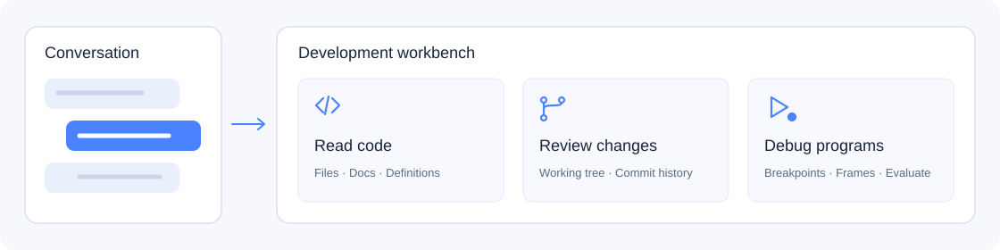
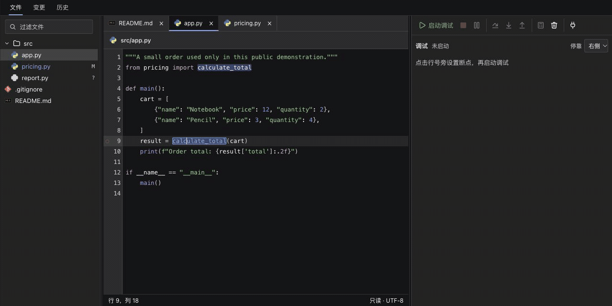
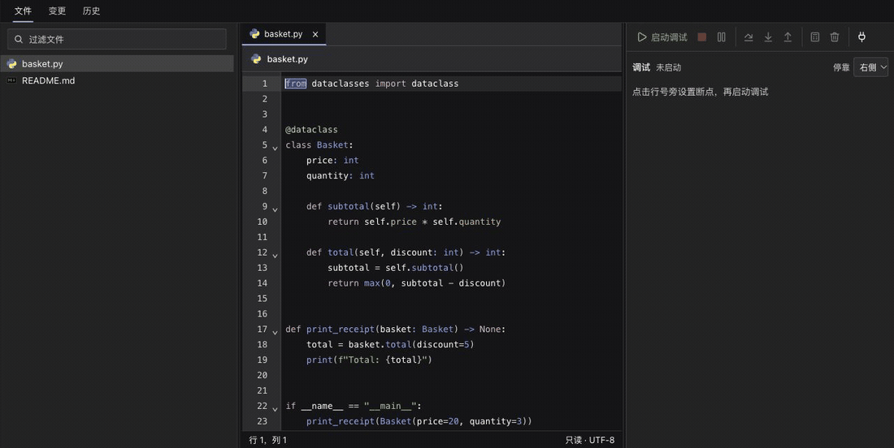

<p align="center"></p>

<h1 align="center">dsh-workbench</h1>

<p align="center"><strong>Keep the conversation. Follow the code.</strong><br />A development workbench beside DeepSeek Harness conversations.</p>

<p align="center"><a href="https://github.com/Chengyunlai/dsh-workbench/actions/workflows/ci.yml"></a> <a href="LICENSE"></a> <a href="https://github.com/deepseek-ai/deepseek-harness"></a> <a href="#language-support"></a></p>

<p align="center"><a href="README.md">中文</a> · English　|　<a href="#demos">Demos</a> · <a href="#install">Get started</a> · <a href="USAGE.en.md">User guide</a> · <a href="https://github.com/Chengyunlai/dsh-workbench/issues">Report an issue</a></p>


## Summary

After an AI suggests changes, open the files beside the conversation, follow definitions, inspect the diff, and use a breakpoint to see what actually runs. Files, source, documents, Git, and debugging share one workbench while the conversation stays visible.

Interactions take cues from JetBrains: file tabs, code folding, modifier-click definitions, Back/Forward, and stack frames linked to source. Resize the reader, tree, and debugger; dock debugging on the right or bottom and follow the host’s light/dark theme.

## Capabilities



| Read the code | Review the changes | Inspect execution |
| --- | --- | --- |
| File trees, tabs, syntax and occurrence highlighting, definitions, code folding, and reading history. Markdown opens as a reading preview with a source view. | Inspect working-tree changes, line diffs, commit graphs, and commit details. Follow a diff back to source and explicitly send selected lines to a new project conversation. | Launch or attach, set breakpoints, step, select stack frames, expand variables, evaluate expressions, and remove all breakpoints. |

## Demos

These are real Harness screens using a fictional Sample Shop project. Select a screenshot to open its GIF.

<table><tr><td width="33%" align="center"><a href="https://raw.githubusercontent.com/Chengyunlai/dsh-workbench/demo-assets/demos/2026-11-02-c0f7910/code-navigation.gif"></a><br /><strong>Code and documents</strong></td><td width="33%" align="center"><a href="https://raw.githubusercontent.com/Chengyunlai/dsh-workbench/demo-assets/demos/2026-11-02-c0f7910/git-inspection.gif"></a><br /><strong>Git diffs and history</strong></td><td width="33%" align="center"><a href="https://raw.githubusercontent.com/Chengyunlai/dsh-workbench/demo-assets/demos/2026-11-02-c0f7910/debugger-evaluate.gif"></a><br /><strong>Breakpoints and evaluation</strong></td></tr></table>

<details>
<summary><strong>Play: breakpoints, variables, and Evaluate Expression</strong></summary>

Hit a Python breakpoint, step into a function, inspect variables, evaluate and expand an object, then remove breakpoints and resume.



</details>

<details>
<summary><strong>Play: code folding retained across file tabs</strong></summary>

Fold a method and its class, switch to a document, and return. Unfolding the class keeps the inner fold; select the ellipsis to expand it. Navigation and debug locations reveal hidden destinations.



</details>

<details>
<summary>Recording and privacy notes</summary>

The cover is a concept illustration; product screenshots and GIFs come from isolated Harness Web 0.2.1-rc.5 instances on macOS. Code, commit authors, and business data are fictional; account and absolute-path areas are excluded. GIFs combine verified screenshots with edited reading holds, not response-time measurements. Navigation, Git, and debugging use real Git, Pyright, and debugpy without model calls. The folding run’s model request returned AUTH without a completed response; folding itself does not call a model.

</details>

## Install

**1. Clone the project and install runtime dependencies.** The repository includes a built client; using it requires no build.

```sh
git clone https://github.com/Chengyunlai/dsh-workbench.git
cd dsh-workbench
npm ci --omit=dev
```

**2. Install this local directory through the Harness plugin manager and enable Development workbench.** In a project conversation, expand the right sidebar and open it from Start or More tools.

Start by opening a file. After configuring a debug adapter, set a breakpoint beside a line number and press F5, or attach through the source context menu. See the [user guide](USAGE.en.md) for shortcuts and language setup, and [debug configuration](DEBUGGING.en.md) for launch and attach arguments.

## Language support

All five languages support source reading and syntax folding; definitions and debugging use the services below.

| Language | Definitions | Launch / attach |
| --- | --- | --- |
| Python | Pyright | debugpy |
| Go | gopls | Delve |
| Java | Eclipse JDT LS | Unavailable |
| JavaScript | TypeScript language service | vscode-js-debug (Node.js) |
| TypeScript | TypeScript language service | vscode-js-debug (requires JS and source maps) |

JS/TS and Python navigation dependencies ship with the installation; Go and Java require local language servers. Debugging needs separately configured local adapters; TypeScript needs generated JS and source maps. See [language setup](USAGE.en.md#five-language-support-and-configuration) and [debug adapter setup](DEBUGGING.en.md#adapters).

## Scope

- Works with registered Git projects in Harness. Source and Git inspection are read-only, without source editing, staging, commits, resets, or branch switching.
- Launching a debugger runs a real program that can write files or access external services. `.dsh/debug.json` is only needed for custom project arguments.
- File tabs, reading history, folds, and breakpoints live in panel memory; closing it does not retain durable project state.
- Java debugging, conditional breakpoints, and automatic builds are unavailable. Markdown images display their descriptions.

## Documentation and contributions

| Your task | Start here |
| --- | --- |
| Read code, configure languages, and resize layouts | [User guide](USAGE.en.md) |
| Configure debuggers, launch, or attach | [Debug configuration](DEBUGGING.en.md) |
| Report a problem or submit a PR | [Contribution guide](CONTRIBUTING.en.md) · [Issues](https://github.com/Chengyunlai/dsh-workbench/issues) |
| Understand CI and releases | [Automation and releases](AUTOMATION.en.md) |
| Privately report a vulnerability | [Security reporting](SECURITY.en.md) |

macOS desktop checks cover reading, navigation, folding, themes, and layout. CI runs core tests on Linux/macOS and package installation checks on Linux, with separate real language-server and debugger integration tests. Windows/Linux desktop interaction is not verified. Sanitized minimal reproductions are welcome.

<details>
<summary>Development and existing installations</summary>

For development tests, use Node.js 24.15.0 or a newer 24.x release and run `npm ci`, `npm run verify`, and `npm run test:package`. The package remains `@local/dsh-git-control`; existing Cordis configuration, right-side tabs, preference keys, and `/api/git.*` routes retain their identifiers. The UI name is Development workbench.

</details>

Code is licensed under [MIT](LICENSE). The editor uses CodeMirror (MIT), UI icons use Lucide (ISC), and file icons come from vscode-icons (MIT); bundled dependency license notices remain in the client.
