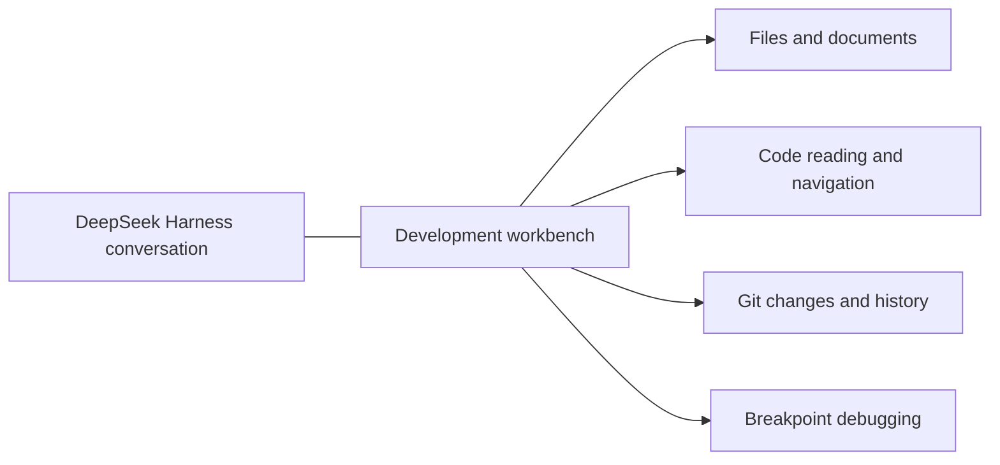
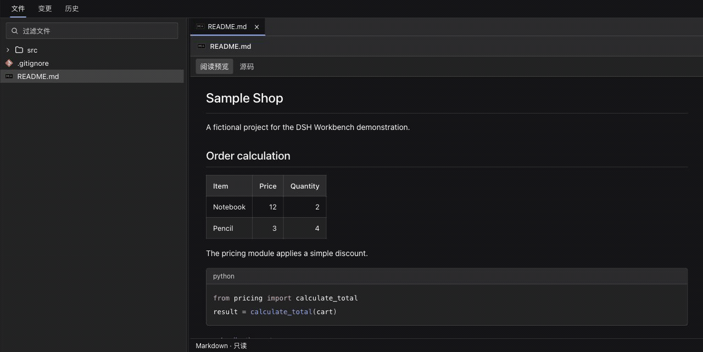
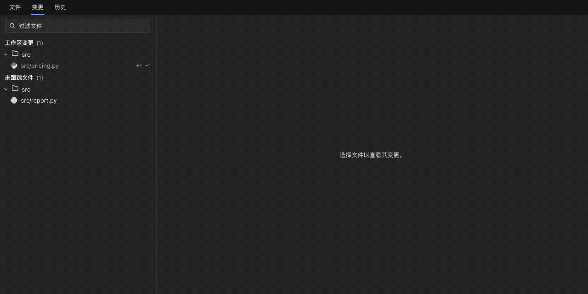

# dsh-workbench · Development workbench

English | [中文](README.md)

## Summary

Inspect projects, follow code, and debug programs beside DeepSeek Harness conversations. dsh-workbench combines a file tree, source and document reading, Git inspection, and breakpoint debugging in one right-side workbench while keeping the conversation visible. Source reading and Git inspection are read-only; launching a debugger executes a real program.

## Contents

- [Capabilities](#capabilities)
- [Capability demos](#capability-demos)
- [Language support](#language-support)
- [Install](#install)
- [Use](#use)
- [Scope](#scope)
- [Documentation and verification](#documentation-and-verification)
- [Contributing](#contributing)
- [Development and compatibility](#development-and-compatibility)

## Capabilities

| Capability | What you can do |
| --- | --- |
| Project browsing | Browse a file tree, filter paths, see Git status markers, and resize panes |
| Code reading | Read multiple tabs with syntax and occurrence highlighting, function/type definitions, and navigation history |
| Documents | Switch Markdown between reading preview and source, follow document links, and read highlighted configuration files |
| Git inspection | Inspect changes, unified diffs, commit graphs, and commit details alongside current source |
| Debugging | Launch or attach, set breakpoints, resume, pause, step, and inspect frames, variables, expression results, and output; remove all breakpoints |
| Conversation handoff | Explicitly send file or commit references, or selected diff lines, with a review suggestion to a new project conversation |



## Capability demos

These demonstrations use the fictional Sample Shop project, with sample code, commit authors, and business data.

**Documents and code navigation**: preview Markdown, switch to source, then follow a definition across files.



<details>
<summary>Git diffs and commit history</summary>

Inspect working-tree changes, line diffs, the commit graph, and individual commit details.



</details>

<details>
<summary>Breakpoints, stepping, variables, and expression evaluation</summary>

Hit a Python breakpoint, step into a function, inspect variables, evaluate and expand an object, then remove breakpoints and resume.


</details>

<details>
<summary>Recording and privacy notes</summary>

Recorded in an isolated Harness Web 0.2.1-rc.5 instance on macOS using [this workbench revision](https://github.com/Chengyunlai/dsh-workbench/tree/c0f7910947fba167619a6526c84b343348ebfcea). Git, Pyright, and debugpy are real services; no model call ran. Account and absolute-path areas are excluded, and no existing conversation or real project appears. The GIFs present verified screenshots from the interaction sequence; hold times are edited for reading and do not represent response latency.

</details>

## Language support

| Language | Reading and definitions | Launch / attach |
| --- | --- | --- |
| Python | Pyright | debugpy |
| Go | gopls | Delve |
| Java | Eclipse JDT LS | Unavailable |
| JavaScript | TypeScript language service | vscode-js-debug (Node.js) |
| TypeScript | TypeScript language service | vscode-js-debug (requires JS and source maps) |

JS/TS and Python navigation dependencies ship with the installation; Go and Java need local language servers. Debugging requires separately configured local adapters. See the [user guide](USAGE.en.md#five-language-support-and-configuration) and [debug configuration](DEBUGGING.en.md).

## Install

Clone the repository and install runtime dependencies. The repository ships a built client, so using it does not require a build.

```sh
git clone https://github.com/Chengyunlai/dsh-workbench.git
cd dsh-workbench
npm ci --omit=dev
```

Install this local directory through the DeepSeek Harness plugin manager, then enable Development workbench. Existing installations show the new display name after updating; their installation path can stay the same.

## Use

1. Expand a project conversation’s right sidebar and open **Development workbench** from Start or More tools.
2. Open source or documents under Files. Use file tabs, modifier-click, and F12 to follow definitions; inspect Git under Changes and Log.
3. After configuring an adapter, set a breakpoint in a Python, Go, or Node.js entry and press F5, or choose Attach to process from the source context menu.
4. When paused, select frames and expand variables. Dock the debugger on the right or bottom; drag pane dividers to resize, with sizes retained.

See the [user guide](USAGE.en.md) for shortcuts, language setup, and reading behavior; see [debug configuration](DEBUGGING.en.md) for launch arguments, attach, and process ownership.

## Scope

- Works with registered Git projects in Harness. Source is read-only; Git has no staging, commits, resets, or branch switching.
- A debugged program can write files or access external services; prepare its development environment before launching it. `.dsh/debug.json` is only needed for custom project arguments.
- Breakpoints, source tabs, and reading history live in the current panel’s memory and are not restored as durable project state after closing it.
- Java debugging, source editing, conditional breakpoints and automatic builds are unavailable. Markdown images currently display their descriptions.

## Documentation and verification

- [User guide](USAGE.en.md): reading, navigation, layout, Git, and language services.
- [Debug configuration](DEBUGGING.en.md): adapters, current-file debugging, launch, and attach.
- Default tests use temporary Git projects, simulated language servers and DAP adapters, and the real client DOM. They require no model API key.
- macOS desktop checks cover code/documents, definitions, occurrence highlighting, light/dark themes, and side/bottom pane sizing. Real language servers and debuggers have separate environment tests; Windows/Linux desktop interaction is not verified.

## Contributing

Read the [contribution guide](CONTRIBUTING.en.md) before opening an issue or PR; use [private security reporting](SECURITY.en.md) for vulnerabilities. See [automation](AUTOMATION.en.md) for core CI, real integration tests, and release steps.

## Development and compatibility

<details>
<summary>Build, test, and existing installation identifiers</summary>

```sh
npm ci
npm test
npm pack --dry-run
```

`build-client.mjs` bundles the client sources into `client.js` using host React. The installation package remains `@local/dsh-git-control`; Cordis configuration, dock tabs, preference keys, and `/api/git.*` routes keep their identifiers so renaming the repository does not create duplicate installations or lose settings. The project and UI use dsh-workbench / Development workbench.

</details>

Project code is [MIT](LICENSE). The editor uses CodeMirror (MIT); UI icons use Lucide (ISC), and file-type icons come from vscode-icons (MIT). Bundled dependency license notices remain in the client artifact.
