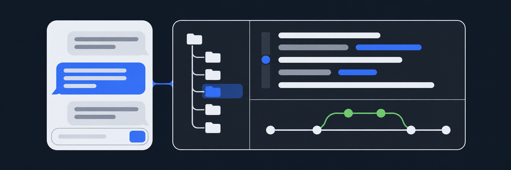
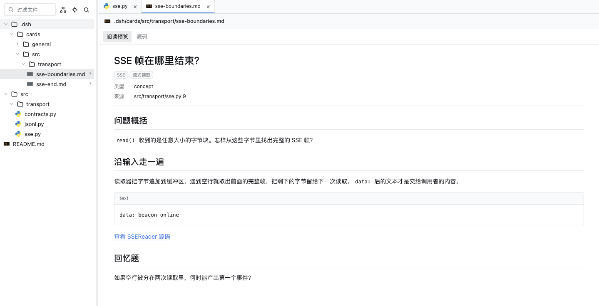
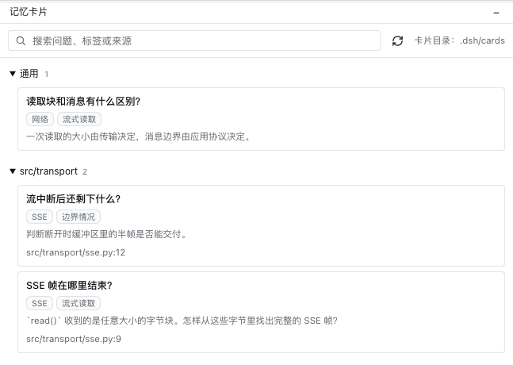
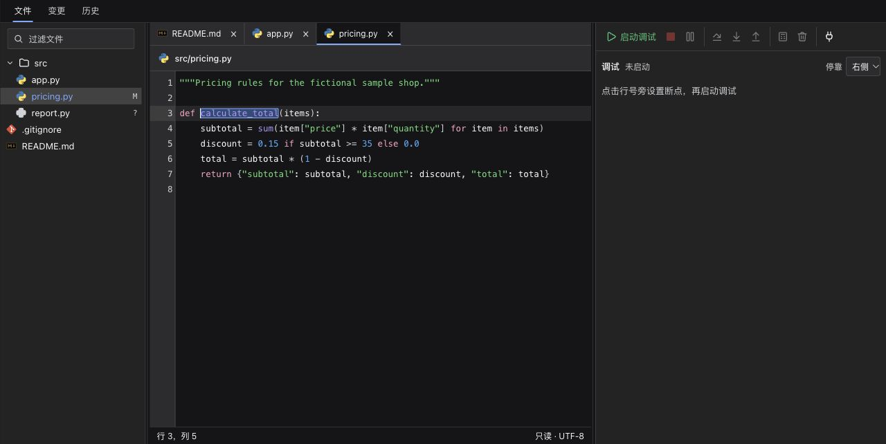
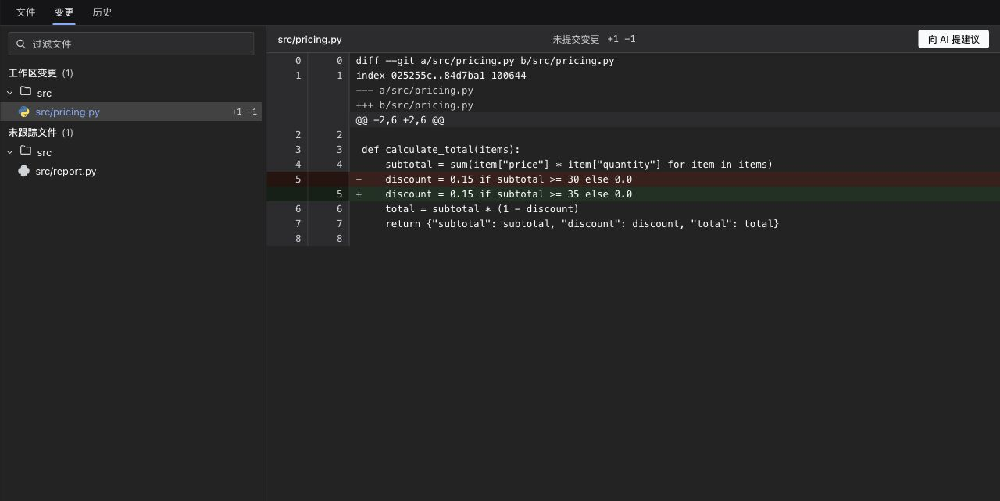
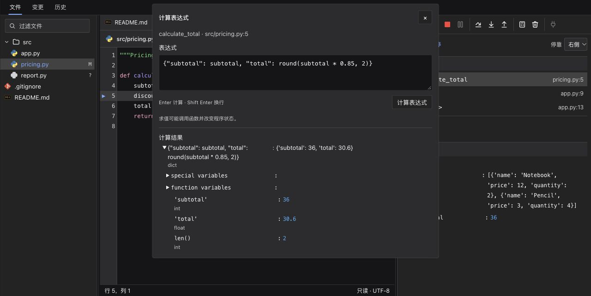
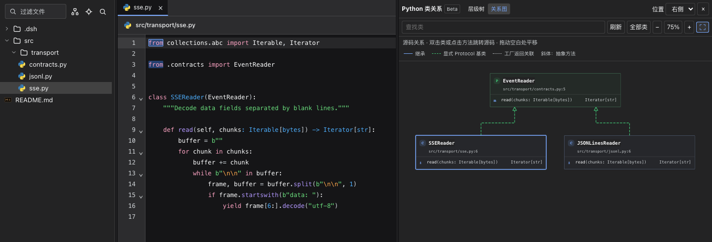
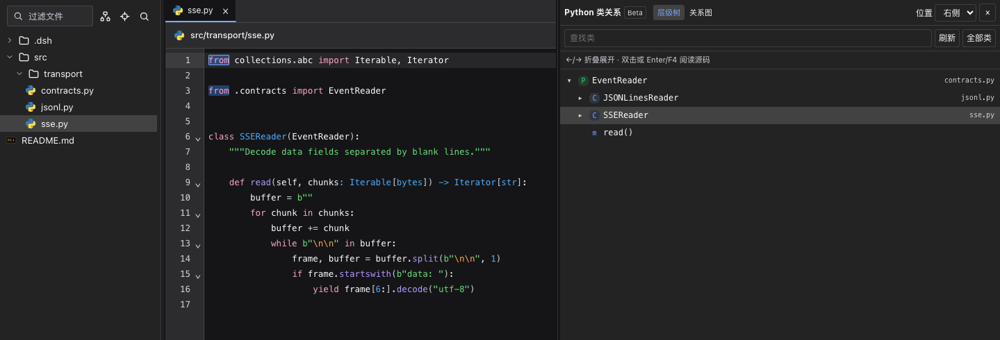
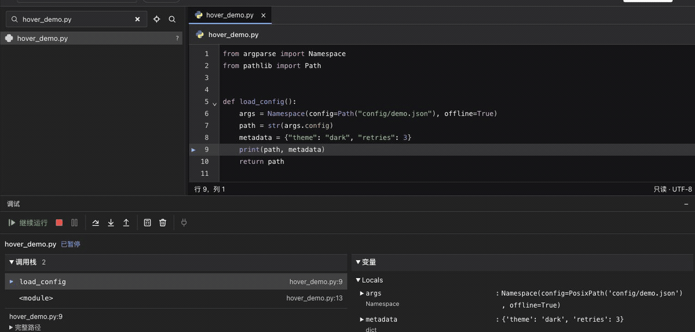

<p align="center"></p>

<h1 align="center">dsh-workbench</h1>

<p align="center"><strong>Keep the conversation. Follow the code.</strong><br />A right-side workbench in DeepSeek Harness for reading source, reviewing changes, debugging programs, and keeping explanations.</p>

<p align="center"><a href="https://www.npmjs.com/package/@yunlai/dsh-workbench"></a> <a href="https://github.com/Chengyunlai/dsh-workbench/actions/workflows/ci.yml"></a> <a href="LICENSE"></a> <a href="https://github.com/deepseek-ai/deepseek-harness"></a> <a href="https://dshopen.org/zh/plugins/@yunlai/dsh-workbench/"></a></p>

<p align="center"><a href="README.md">中文</a> · English　|　<a href="#quick-start">Install</a> · <a href="#what-the-workbench-does">Features</a> · <a href="#demos">Demos</a> · <a href="https://github.com/Chengyunlai/dsh-workbench/releases/latest">Latest release</a></p>



After the agent changes code, open the diff on the right, jump from a changed line to the source, and follow definitions to the implementation. Send a question to an explanation conversation when you want to understand a piece of code, then revisit its card in the workbench. Resize the file tree, editor, and bottom tool window while keeping your conversation in view.

## Quick start

1. In the DeepSeek Harness plugin manager, install `@yunlai/dsh-workbench` and enable Development workbench.
2. Open a conversation for a registered Git project. Expand the right sidebar and choose Development workbench from Start or More tools.
3. Open a file from the tree. Press `F12` in supported source files to jump to a definition, or open Changes at the bottom to inspect a diff.

For online installs, check for updates in plugin details, then reload or restart Harness. The current package requires Harness `0.2.1-rc.5` or newer and Node.js `22.14.0` or newer. [Download ZIP](https://github.com/Chengyunlai/dsh-workbench/releases/latest) · [Upgrade guide](UPGRADING.en.md)

<details>
<summary>Install from a ZIP or source directory</summary>

Extract the ZIP from the release, install dependencies as described in `INSTALL.txt`, and select the extracted directory in the Harness plugin manager. You can also clone and install the source directory.

```sh
git clone https://github.com/Chengyunlai/dsh-workbench.git
cd dsh-workbench
npm ci --omit=dev
```

</details>

## What the workbench does

| Task | How to do it in the workbench |
| --- | --- |
| **Read source** | Find code with the file tree and content search. Tabs retain reading positions and support highlighting, folding, occurrence highlighting, definitions, and Back/Forward. Right-click a tab to close it, the other tabs, or all tabs. |
| **Explore Python class relationships** | Open a hierarchy tree or docked diagram from the file-tree toolbar or Python source menu. Inspect inheritance, abstract classes, declared Protocol bases, and factory return associations grounded in source. Open source from class and method nodes. Class relationships are currently Python-only and in beta. |
| **Read documents and images** | Open Markdown from a conversation in a reading preview or switch to source. The preview shows YAML titles, tags, and fields, highlighted code blocks, and file links. Tabs also preview images and icons such as PNG, SVG, and ICNS. |
| **Review Git changes** | Browse staged, working-tree, and untracked changes, line diffs, commit graphs, and commit details. Double-click a diff line to open current source. Send selected diff lines to a new conversation as a change task or an explanation. |
| **Inspect execution** | Launch or attach, set breakpoints, step, and select stack frames. While paused, inspect values on hover, expand objects, see inline values, or evaluate an expression. Clear all breakpoints in one action. |
| **Run project commands** | Open the bottom terminal to run commands in the current conversation’s workspace using the Harness terminal service. The editor stays visible while you switch among Find, Changes, History, Memory cards, and Debugger. |

Python diagrams use static source analysis. Definition results can open supported library sources and declaration files in read-only library tabs. [Class relationships](USAGE.en.md#python-class-relationships) · [Navigation limits](USAGE.en.md#navigation-behavior-and-limits)

## Explanations and memory cards

Suppose you are reading a `stream()` method and want to know where SSE bytes become frames and then model events. Right-click the file, select Explain it to me, and enter the question. The new conversation is prompted to trace the source with a concrete input and save the full explanation in one card. The card opens with a question recap and ends with a prompt to recall the mechanism or predict an edge case.

The Memory cards tool groups cards by archive folder and searches titles, summaries, tags, sources, and paths in combination. Cards are Markdown files in the project and default to `.dsh/cards/`. Linked cards use the nearest two source directories, questions without linked source go under `general/`, and existing cards can be grouped in the index by their source metadata. [Memory cards guide](USAGE.en.md#memory-cards)



<details>
<summary>View the grouped card index</summary>



</details>

## Demos

These recordings use fictional projects. Select a screenshot to open its GIF.

<table><tr><td width="33%" align="center"><a href="https://raw.githubusercontent.com/Chengyunlai/dsh-workbench/demo-assets/demos/2026-11-02-c0f7910/code-navigation.gif"></a><br /><strong>Code and documents</strong></td><td width="33%" align="center"><a href="https://raw.githubusercontent.com/Chengyunlai/dsh-workbench/demo-assets/demos/2026-11-02-c0f7910/git-inspection.gif"></a><br /><strong>Git diffs and history</strong></td><td width="33%" align="center"><a href="https://raw.githubusercontent.com/Chengyunlai/dsh-workbench/demo-assets/demos/2026-11-02-c0f7910/debugger-evaluate.gif"></a><br /><strong>Breakpoints and expression evaluation</strong></td></tr></table>

### Python class relationships



<details>
<summary>View the same classes in the hierarchy tree</summary>



</details>

### Inspect values on hover while paused



<details>
<summary>More demos and recording notes</summary>

[Code folding and tab restoration](https://raw.githubusercontent.com/Chengyunlai/dsh-workbench/demo-assets/demos/2026-11-03-beecb54/code-folding.gif) · [Debugger hover recording notes](https://github.com/Chengyunlai/dsh-workbench/blob/demo-assets/demos/2026-11-04-dc2b2e3/RECORDING.md)

The cover is a concept illustration. The class and card screenshots show the Chinese interface of workbench `1.4.1` running in Harness Web with a fictional Beacon Stream project and sample cards. Other demos come from earlier isolated runs. The GIFs use edited holds between steps.

</details>

## Language support

The table separates definition navigation from debugging. All five languages support read-only browsing, syntax highlighting, and folding. Go and Java require local language-server setup. Python and JS/TS navigation dependencies ship with the package.

| Language | Definitions | Launch and attach |
| --- | --- | --- |
| Python | Pyright | debugpy |
| Go | gopls | Delve |
| Java | Eclipse JDT LS | Unavailable |
| JavaScript | TypeScript language service | vscode-js-debug (Node.js) |
| TypeScript | TypeScript language service | vscode-js-debug (requires emitted JS and source maps) |

Configure a debug adapter separately. Then set a breakpoint and press `F5` in source, or attach through the context menu. For custom launch arguments, use `.dsh/debug.json`. [Language setup](USAGE.en.md#five-language-support-and-configuration) · [Debug setup](DEBUGGING.en.md#adapters)

## Scope

- Edit existing text files directly in source view and save with `⌘S` / `Ctrl+S`. Review the resulting Git diff in Changes.
- Terminal and debugging execute real commands or programs. The explanation conversation writes cards into the project, where workspace permissions and Git rules apply.
- CI covers Linux and macOS core checks, package installation, and real language servers and debuggers. Desktop interaction has been tested on macOS. Windows and Linux desktop interaction remain unverified.

## Documentation and contributions

| Task | Guide |
| --- | --- |
| Use the workbench, configure languages, and resize panels | [User guide](USAGE.en.md) |
| Set up debuggers, launch, and attach | [Debug guide](DEBUGGING.en.md) |
| Read version changes or migrate an installation | [Upgrade guide](UPGRADING.en.md) |
| Report a problem or submit a PR | [Contribution guide](CONTRIBUTING.en.md) · [Issues](https://github.com/Chengyunlai/dsh-workbench/issues) |
| Understand CI, releases, and security reporting | [Automation and releases](AUTOMATION.en.md) · [Security reporting](SECURITY.en.md) |

The project is [MIT](LICENSE) licensed. The editor uses CodeMirror, interface icons are from Lucide, and file icons are from vscode-icons. [Dependency notices](THIRD_PARTY_NOTICES.txt)
