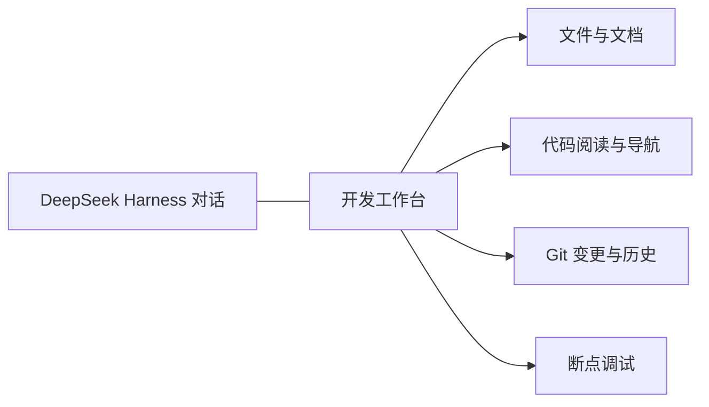

# dsh-workbench · 开发工作台

[English](README.en.md) | 中文

## 简介

在 DeepSeek Harness 对话旁查看项目、追踪代码并调试程序。dsh-workbench 将文件树、源码与文档阅读、Git 差异和断点调试放进同一个右侧工作台，保留中间的对话上下文。代码阅读与 Git 检查只读；启动调试会执行真实程序。

## 目录

- [能力](#能力)
- [语言支持](#语言支持)
- [安装](#安装)
- [使用](#使用)
- [适用范围](#适用范围)
- [文档与验证](#文档与验证)
- [开发与兼容](#开发与兼容)

## 能力

| 能力 | 在工作台中完成 |
| --- | --- |
| 项目浏览 | 文件树、路径过滤、Git 状态标记，以及可拖动调整的区域 |
| 代码阅读 | 多文件标签、语法高亮、同名词高亮、函数与类型定义跳转、阅读历史 |
| 文档阅读 | Markdown 排版预览与源码切换，文档内链接，以及常用配置文件高亮 |
| Git 检查 | 工作区变更、统一 diff、提交图与提交详情，联动当前源码 |
| 断点调试 | 启动或接入进程、断点、继续、暂停、单步、调用栈、变量、表达式求值、清理全部断点和程序输出 |
| 与对话协作 | 手动将文件、提交或选中的 diff 片段连同评审建议发到项目新对话 |



## 语言支持

| 语言 | 阅读与定义跳转 | 启动／接入调试 |
| --- | --- | --- |
| Python | Pyright | debugpy |
| Go | gopls | Delve |
| Java | Eclipse JDT LS | 暂无 |
| JavaScript | TypeScript 语言服务 | vscode-js-debug（Node.js） |
| TypeScript | TypeScript 语言服务 | vscode-js-debug（需 JS 与 source map） |

JS／TS 与 Python 导航依赖随安装提供；Go、Java 需要本机语言服务。调试需要另行配置本机适配器。环境与配置步骤分别见[使用指南](USAGE.md#五种语言的支持与配置)和[调试配置](DEBUGGING.md)。

## 安装

克隆项目并安装运行依赖；仓库包含已构建的客户端，使用时无需构建。

```sh
git clone https://github.com/Chengyunlai/dsh-workbench.git
cd dsh-workbench
npm ci --omit=dev
```

在 DeepSeek Harness 的插件管理器中安装此本地目录，然后启用“开发工作台”。已有安装升级后会显示新名称；安装目录可沿用原路径。

## 使用

1. 在项目对话中展开右侧工具区，从“开始”或“更多工具”打开 **开发工作台**。
2. 在“文件”中打开代码或文档；用文件标签、修饰键点击和 F12 追踪定义，在“变更”和“历史”检查 Git。
3. 配好适配器后，在 Python、Go 或 Node.js 入口设置断点，按 F5 启动；也可右键选择“接入已有进程”。
4. 暂停后切换栈帧并展开变量。调试面板可停靠右侧或底部，区域分隔线可拖动，尺寸自动保存。

完整快捷键、语言服务配置和阅读交互见[使用指南](USAGE.md)；启动参数、进程接入与调试进程归属见[调试配置](DEBUGGING.md)。

## 适用范围

- 面向 Harness 已注册的 Git 项目；源码不支持编辑，Git 不提供暂存、提交、回滚或分支切换。
- 调试启动的程序可能修改文件或访问外部服务，使用前应准备好开发环境。`.dsh/debug.json` 只在需要自定义项目参数时使用。
- 断点、源码标签和阅读历史保存在当前面板内存中；关闭面板后不作为持久项目状态恢复。
- Java 调试、源码编辑、条件断点和自动构建不在当前能力内。Markdown 图片当前显示说明文字。

## 文档与验证

- [使用指南](USAGE.md)：阅读、导航、布局、Git 与语言服务。
- [调试配置](DEBUGGING.md)：适配器、当前文件调试、启动与接入配置。
- 默认测试使用临时 Git 项目、模拟语言服务和 DAP 适配器，以及实际客户端 DOM；不需要模型 API 密钥。
- macOS 桌面端已验证代码与文档阅读、定义跳转、同名高亮、明暗主题，以及侧栏与底部的尺寸调整。真实语言服务和调试器有独立的手动环境测试；Windows／Linux 尚无桌面交互验收。

## 开发与兼容

<details>
<summary>构建、测试与既有安装标识</summary>

```sh
npm ci
npm test
npm pack --dry-run
```

客户端源码由 `build-client.mjs` 打包到 `client.js`，复用宿主 React。安装包名继续使用 `@local/dsh-git-control`；已有 Cordis 配置、右侧标签、偏好键和 `/api/git.*` 路由保持原标识，避免仓库更名导致重复安装或丢失设置。项目名称与用户界面统一为 dsh-workbench／开发工作台。

</details>

项目代码采用 [MIT](LICENSE)。编辑器使用 CodeMirror（MIT）；界面图标使用 Lucide（ISC），文件类型图标来自 vscode-icons（MIT）。打包依赖的许可声明保留在客户端产物中。
