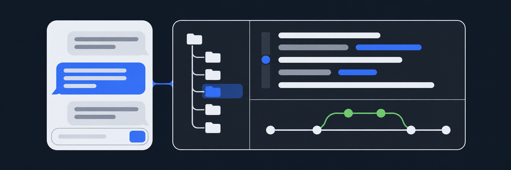
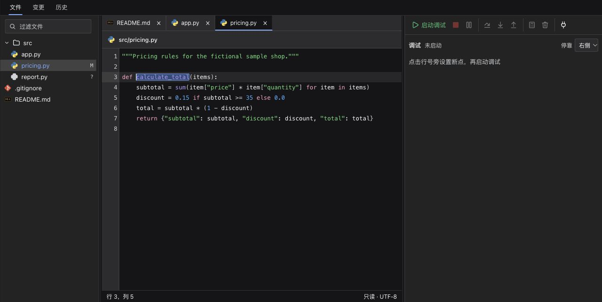
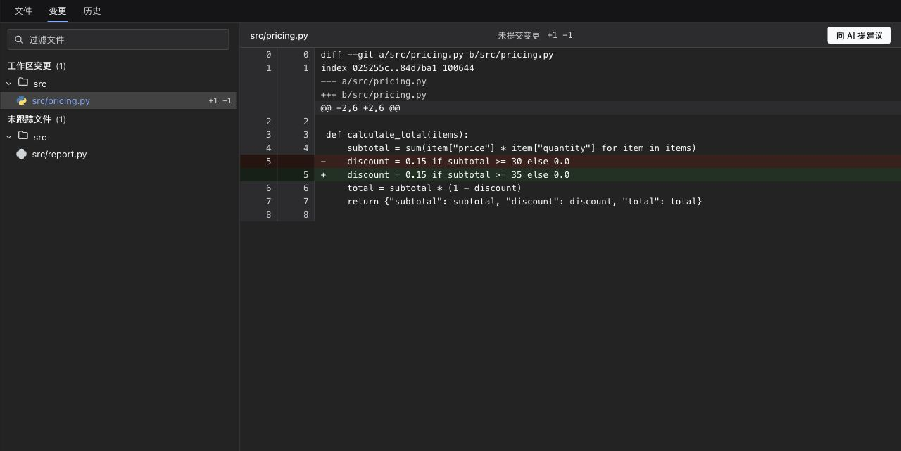
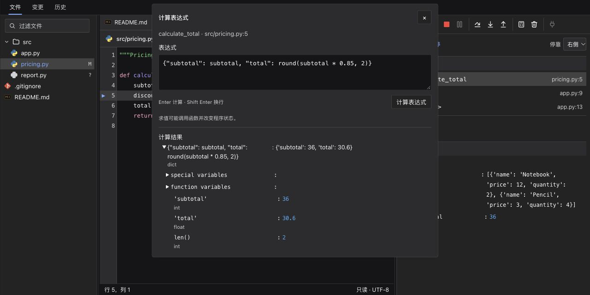
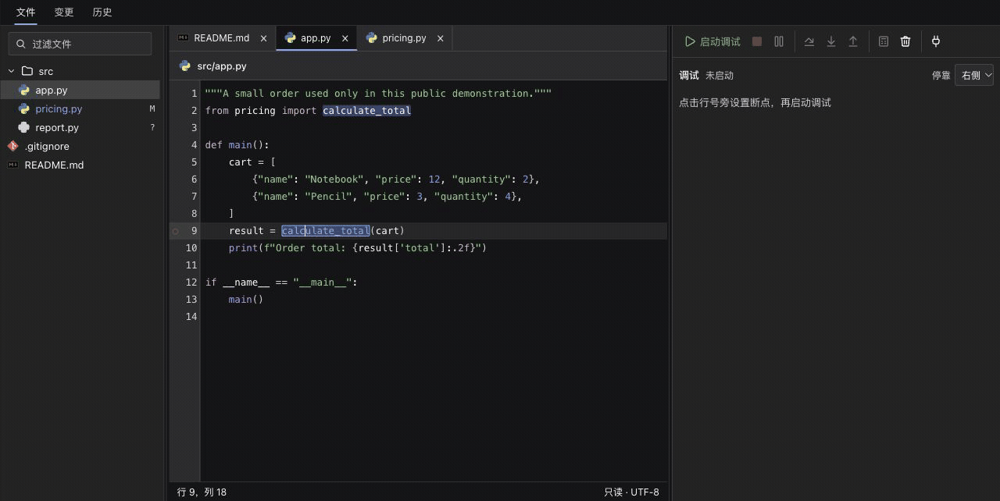
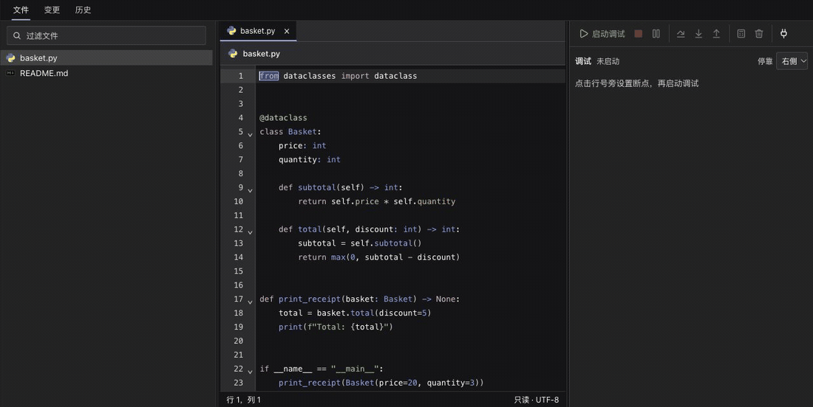

<p align="center"></p>

<h1 align="center">dsh-workbench</h1>

<p align="center"><strong>对话留在中间，代码就在手边。</strong><br />DeepSeek Harness 对话旁的开发工作台。</p>

<p align="center"><a href="https://github.com/Chengyunlai/dsh-workbench/actions/workflows/ci.yml"></a> <a href="LICENSE"></a> <a href="https://github.com/deepseek-ai/deepseek-harness"></a> <a href="#语言支持"></a></p>

<p align="center">中文 · <a href="README.en.md">English</a>　|　<a href="#能力演示">看演示</a> · <a href="#安装">开始使用</a> · <a href="USAGE.md">使用指南</a> · <a href="https://github.com/Chengyunlai/dsh-workbench/issues">反馈问题</a></p>



## 简介

AI 给出改动后，你可以就在对话旁打开文件、沿着定义跳转、逐行检查 diff，再用断点确认程序如何执行。文件树、代码、文档、Git 和调试共用一个工作台，保留当前对话上下文。

交互参考 JetBrains：多文件标签、代码折叠、修饰键点击跳转、前进／后退，以及联动源码的调用栈。文件树与工具窗口可拖动调整，并跟随宿主明暗主题。查找、变更、历史、调试和终端通过底部图标切换，共用一个窗口，代码阅读区持续保留。终端按需加载，可直接运行项目命令。

## 能力


| 读懂代码 | 看清改动 | 检查真实执行 |
| --- | --- | --- |
| 文件树、路径复制、文件与目录查找、多标签、语法高亮、同名词高亮、定义跳转、代码折叠和阅读历史。对话中的 Markdown 可直接进入工作台阅读预览，也可切回源码；图片和 ICNS 图标可直接预览。 | 查看工作区变更、逐行 diff、提交图和提交详情；从差异跳回源码，手动把选中的 diff 交给项目新对话讨论。 | 启动或接入已有进程，设置断点、单步、切换调用栈、展开变量、计算表达式，并清理全部断点。 |

## 能力演示

以下是真实 Harness 界面，使用虚构的 Sample Shop 项目。点击截图可查看对应 GIF。

<table><tr><td width="33%" align="center"><a href="https://raw.githubusercontent.com/Chengyunlai/dsh-workbench/demo-assets/demos/2026-11-02-c0f7910/code-navigation.gif"></a><br /><strong>代码与文档阅读</strong></td><td width="33%" align="center"><a href="https://raw.githubusercontent.com/Chengyunlai/dsh-workbench/demo-assets/demos/2026-11-02-c0f7910/git-inspection.gif"></a><br /><strong>Git 差异与历史</strong></td><td width="33%" align="center"><a href="https://raw.githubusercontent.com/Chengyunlai/dsh-workbench/demo-assets/demos/2026-11-02-c0f7910/debugger-evaluate.gif"></a><br /><strong>断点与表达式求值</strong></td></tr></table>

<details>
<summary><strong>播放：断点、变量与 Evaluate Expression</strong></summary>

命中 Python 断点，进入函数、查看变量，计算并展开对象结果，最后清理断点、继续运行。



</details>

<details>
<summary><strong>播放：代码折叠与文件切换恢复</strong></summary>

折叠函数及外层类，切到文档再返回；展开外层时保留内层折叠，点击省略号展开代码。跳转和调试定位进入隐藏代码时会自动展开目标区域。



</details>

<details>
<summary>录制与脱敏说明</summary>

主视觉为概念插画，功能截图与 GIF 来自 macOS 上独立的 Harness Web 0.2.1-rc.5 实例。代码、提交作者和业务数据均为虚构；画面排除了账号与绝对路径区域。GIF 由已验证的操作截图按步骤组成，停留时长经过编辑，不代表响应耗时。代码导航、Git 与调试演示使用真实 Git、Pyright 和 debugpy，未调用模型；折叠演示中的模型请求返回 AUTH，未完成模型回复，折叠操作本身不调用模型。

</details>

## 安装

**1. 在线安装。** 在 Harness 插件管理器的“安装插件”中输入 `@yunlai/dsh-workbench`。从插件详情检查并选择新版本；按提示重载或重启。需要本地开发时也可使用以下源码安装方式：

```sh
git clone https://github.com/Chengyunlai/dsh-workbench.git
cd dsh-workbench
npm ci --omit=dev
```

**2. 在 Harness 插件管理器中安装这个本地目录，启用“开发工作台”。** 在项目对话中展开右侧工具区，从“开始”或“更多工具”打开它。

先打开一个文件开始阅读。配好调试适配器后，点击行号旁设置断点，按 F5 启动；需要接入已有进程时使用源码右键菜单。快捷键与语言配置见[使用指南](USAGE.md)，启动和接入参数见[调试配置](DEBUGGING.md)。

## 语言支持

五种语言均支持源码阅读与语法折叠；定义跳转和调试使用下表中的服务。

| 语言 | 定义跳转 | 启动 / 接入调试 |
| --- | --- | --- |
| Python | Pyright | debugpy |
| Go | gopls | Delve |
| Java | Eclipse JDT LS | 暂无 |
| JavaScript | TypeScript 语言服务 | vscode-js-debug（Node.js） |
| TypeScript | TypeScript 语言服务 | vscode-js-debug（需 JS 与 source map） |

JS／TS 与 Python 导航依赖随安装提供；Go、Java 需要本机语言服务。调试需要另行配置本机适配器，TypeScript 需先生成 JS 与 source map。详见[语言服务配置](USAGE.md#五种语言的支持与配置)和[调试适配器配置](DEBUGGING.md#安装调试器)。

## 适用范围

- 面向 Harness 已注册的 Git 项目。源码和 Git 检查只读，不提供源码编辑、暂存、提交、回滚或分支切换。
- 启动调试会执行真实程序，可能写文件或访问外部服务。`.dsh/debug.json` 仅用于自定义项目参数。
- 文件标签、阅读历史、折叠和断点保存在当前面板内存中；关闭面板后不作为持久项目状态恢复。
- 当前不支持 Java 调试、条件断点和自动构建。Markdown 图片显示说明文字。

## 文档与贡献

| 你想做什么 | 从这里开始 |
| --- | --- |
| 阅读代码、配置语言服务、调整布局 | [使用指南](USAGE.md) |
| 配置调试器、启动或接入进程 | [调试配置](DEBUGGING.md) |
| 报告问题或提交 PR | [贡献指南](CONTRIBUTING.md) · [Issues](https://github.com/Chengyunlai/dsh-workbench/issues) |
| 了解 CI 和发布流程 | [自动化与发布](AUTOMATION.md) |
| 私密报告安全问题 | [安全报告](SECURITY.md) |

macOS 桌面端已实测阅读、导航、折叠、明暗主题与布局。CI 在 Linux／macOS 运行基础测试，并在 Linux 验收安装包；真实语言服务与调试器另有集成测试。Windows／Linux 桌面交互尚未验收。欢迎用脱敏的最小示例反馈问题。

<details>
<summary>开发与已有安装兼容</summary>

开发测试使用 Node.js 24.15.0 或更新的 24.x，运行 `npm ci`、`npm run verify` 与 `npm run test:package`。安装包名为 `@yunlai/dsh-workbench`，插件条目为 `workbench`；旧版安装按[升级指南](UPGRADING.md)更新引用。右侧标签、偏好键和 `/api/git.*` 路由保留原内部标识，以恢复既有布局。

</details>

代码采用 [MIT](LICENSE) 许可。编辑器使用 CodeMirror（MIT），界面图标使用 Lucide（ISC），文件图标来自 vscode-icons（MIT）；客户端保留打包依赖的许可声明。
